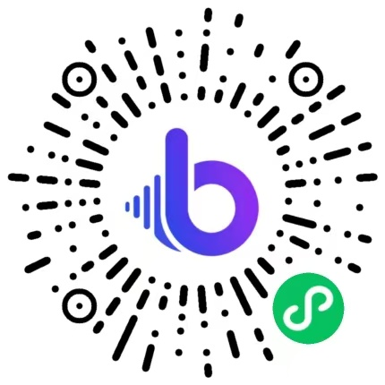

# Multilingual Voiceover Skill

[English](./README.md) | 简体中文 | [日本語](./README.ja.md)

> 👉 也看看 [Talking Avatar Video Skill](https://github.com/beatra-ai/talking-avatar-video-skill)

根据各语言口播稿制作多语言旁白音频，按市场选声，先试听读音、语气和时长，再按语言与片段清晰交付，在 Claude Code、Cursor、Codex、Windsurf、Cline 或 OpenClaw 里直接完成。

> [!IMPORTANT]
> 生成需要 [Beatra](https://beatra.ai?utm_source=github&utm_medium=flagship&utm_campaign=multilingual-voiceover-skill) 账号并消耗积分，安装本身不收费。

| 问题 | 回答 |
| --- | --- |
| **能做什么** | 根据各语言口播稿制作多语言旁白音频，按市场选声，先试听读音、语气和时长，再按语言与片段清晰交付。 |
| **底层模型** | MiniMax Speech 2.8 HD、MiniMax Speech 2.8 Turbo |
| **运行要求** | Python 3.10+，以及能加载 `SKILL.md` 的 Agent |
| **费用** | 安装免费。每次生成消耗 Beatra 账号积分，只有你明确要求这次生成或批准确认卡后才会付费。 |
| **支持的 Agent** | Claude Code、Cursor、Codex、Windsurf、Cline、OpenClaw |

<p align="center"></p>

*四语配音样例的封面图：点阵世界地图上，来自美国、西班牙、中国和日本的声音汇成一条声波。由 Beatra AI 生成。*

| Skill | Entry point | Version |
| --- | --- | --- |
| [`ai-multilingual-dubbing`](skills/ai-multilingual-dubbing) | [SKILL.md](skills/ai-multilingual-dubbing/SKILL.md) | 0.2.9 |

本仓库由 [beatra-ai/beatra-skills](https://github.com/beatra-ai/beatra-skills/tree/main/skills/ai-multilingual-dubbing) 自动发布，问题请到那里反馈。

## 安装

使用 [`skills`](https://skills.sh) CLI：

```bash
npx skills add beatra-ai/multilingual-voiceover-skill
```

使用 GitHub CLI：

```bash
gh skill install beatra-ai/multilingual-voiceover-skill ai-multilingual-dubbing
```

也可以克隆本仓库，把 `skills/ai-multilingual-dubbing` 复制到 `~/.claude/skills/`（Claude Code）、`~/.cursor/skills/`（Cursor）、`~/.agents/skills/`（Codex）、`~/.codeium/windsurf/skills/`（Windsurf）、`~/.cline/skills/`（Cline）或 `~/.openclaw/skills/`（OpenClaw）。

或者把下面这段话发给你的 Agent：

```text
从 https://github.com/beatra-ai/multilingual-voiceover-skill 安装 ai-multilingual-dubbing skill（目录 skills/ai-multilingual-dubbing），然后按它的 SKILL.md 连接我的 Beatra 账号。
```

## 效果示例

<p align="center"></p>

[▶ 试听（MP3）](assets/sample.mp3)

*虚构语言学习应用 Lumo 的同一句产品文案，按四份写好的脚本分别用英语、普通话、西班牙语和日语配音，每种语言一个预设音色。由 Beatra AI 生成。*

在你的 Agent 里这样说：

```text
Lumo 的上线文案我准备了四种语言（./scripts/en.txt、zh.txt、es.txt、ja.txt）。每种语言选一个合适的声音，先做一次简短的发音试读，再按顺序交付四段配音。
```

提示词：

```text
[en] Meet Lumo, the language app that talks back. Ten minutes of real conversation a day, and new words start to stick. Open Lumo, and say hello to the world.
[zh] 认识一下 Lumo，一个会陪你开口说话的语言学习应用。每天十分钟真实对话，新单词自然记得牢。打开 Lumo，向世界打个招呼吧。
[es] Te presentamos Lumo, la app de idiomas que te responde. Diez minutos de conversación real al día, y las palabras nuevas se quedan contigo. Abre Lumo y saluda al mundo.
[ja] Lumoは、話しかけると答えてくれる語学アプリです。毎日10分、本物の会話を続けるだけで、新しい単語が自然と身につきます。Lumoを開いて、世界にあいさつしましょう。
```

## 技术规格与输出限制

截至 2026-10-18。实时列表：https://docs.beatra.ai/zh/docs/models

- **语音合成** — 2 个模型（MiniMax Speech 2.8 HD、MiniMax Speech 2.8 Turbo）；FLAC、MP3、OPUS、PCM、WAV；40 种语言；采样率 8、16、22.05、24、32、44.1 kHz；单次最多 50000 字符
  - 语言（ISO 639 代码）：zh, yue, en, es, fr, ru, de, pt, ar, it, ja, ko, id, vi, tr, nl, uk, th, pl, ro, el, cs, fi, hi, bg, da, he, ms, fa, sk, sv, hr, fil, hu, no, sl, ca, nn, ta, af

## 为什么用 Beatra，而不是直接调用模型 API

- **一个账号用到本 skill 的全部模型** — 语音合成 2（MiniMax Speech 2.8 HD、MiniMax Speech 2.8 Turbo）（截至 2026-10-18），一次 Beatra 登录即可使用，不必分别管理各家模型的 key。
- **花不花钱由你决定** — 只有你明确要求这次生成，或批准显示实时积分估算的确认卡后才会付费。
- **先策划，再生成** — skill 先帮你规划、指导和检查，再在 Beatra 上生成。
- **文件可以核验** — `skills/` 下的每个文件都与 cdn.beatra.ai 上的发布归档逐字节一致，每次推送前用 SHA-256 校验。
- **更新由你掌控** — 不含自更新程序；用安装时的工具更新。
- **在你的 Agent 里运行** — Claude Code、Cursor、Codex、Windsurf、Cline、OpenClaw。

## 你能得到什么

- **从各市场口播稿开始** — 配音前确认产品名、卖点、数字、价格和行动号召，避免关键信息在不同市场发生偏差。
- **为不同受众选择合适声音** — 先从支持目标语言的声音中试听选择，再用代表片段检查实际表现。
- **先试听时长，再扩大制作** — 每个市场先做一个有代表性的片段，检查读音、语气、节奏和返回时长。

## 适用场景

- **出海产品与营销视频** — 根据各语言文案制作产品发布、讲解、广告和跨境电商视频所需的多语言旁白音轨。
- **课程与培训内容** — 按语言、课程和模块整理音频，先试听关键术语、数字和时长。
- **创作者与社交视频** — 为同一内容在不同市场发布准备按语言分类的旁白音频。
- **短剧与系列内容** — 按场景和片段制作对白或旁白音频，并为视频翻译、剪辑、同步和完整内容制作清晰组织素材。

## 常见问题

### 它会自动翻译并配好整条视频吗？

它根据各语言文案制作旁白音频，也可以协助起草更适合当地表达的口播稿；交付音轨按市场和片段整理，便于转录参考、语言审校、口型同步和成片剪辑。

### 多种语言应该怎样选择音色？

为每个市场匹配支持目标语言且适合受众的音色；如果同一声音的语言范围和表达适合完整活动，也可以跨市场沿用。

### 可以先试听再做完整版本吗？

可以。每个市场先制作一个有代表性的片段，检查读音、语气、节奏和时长，再把选定方向应用到其余音频。

### 怎样让旁白贴合原视频时长？

用目标时长指导文案长度和语速，比较试读返回的实际时长，再围绕最终剪辑调整口播稿或镜头节奏。

## 更新与安全

自 2026 年 10 月的版本起，本 skill 不再包含自更新程序：它只运行你安装的文件，从不自行替换。
请用安装时的工具更新——`npx skills update ai-multilingual-dubbing` 或 `gh skill update ai-multilingual-dubbing`。
详见 skill 内的 `references/updates-and-security.md`。

## 许可证

[MIT-0](LICENSE)：可自由使用、修改和再分发，包括商用，无需署名；与这些 skill 在 ClawHub 上的条款一致。

## 相关链接

- 官网 — https://www.beatra.cn?utm_source=github&utm_medium=flagship&utm_campaign=multilingual-voiceover-skill
- 文档 — https://docs.beatra.cn?utm_source=github&utm_medium=flagship&utm_campaign=multilingual-voiceover-skill
- 控制台 — https://console.beatra.cn
- 给 AI Agent 读的说明 — https://www.beatra.cn/llms.txt （索引）· https://www.beatra.cn/llms-full.txt （全部 skill 合成一个文件）

- 微信小程序 — 国内用户微信扫码使用


